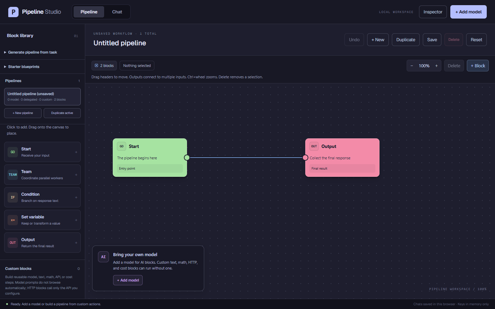

# Pipeline Studio

A local-first, model-neutral pipeline builder and chat workspace for OpenAI-compatible LLMs. Design multi-step pipelines (model calls, delegated "team" blocks, conditions, variables, custom HTTP/model actions) on a canvas, save them, and run them — or plain one-on-one chat — with models you connect yourself.

- Works with OpenRouter, OpenAI, DeepSeek, or any OpenAI-compatible endpoint; no preselected providers.
- Chats run through a saved pipeline or a single direct model, with per-conversation history, instructions, and execution choice.
- Text is extracted locally from uploaded PDF, DOCX, TXT, Markdown, and CSV files before sending.
- Optional outputs: downloadable document, spreadsheet, and archive exports.



## Quick start

```bash
npm install
npm run dev        # http://localhost:3000/builder
npm run build      # production build
npm start          # serve the production build
```

## Security model

- Every model and custom-block API key stays in page memory only: never written to browser storage, exports, or test fixtures. Re-enter keys after reloading.
- You connect and pay for your own models. There is no bundled key, no middleman, and no default provider; costs are billed directly to the accounts you configure.
- Workspace data (pipelines, chats, models without keys) is stored unencrypted per-browser. Use Export/Import for backup and migration between machines.
- This is a single-user local tool, not a hosted multi-user service. Loopback/self-hosted endpoints are disabled by default (`PIPELINE_ALLOW_LOOPBACK=false` in `.env.example`); enable only on a machine you trust, and never expose a loopback-enabled instance to an untrusted network.
- Requests are same-origin with bounded validation in `lib/pipeline/`; the browser never talks to providers directly.

See [`PIPELINE.md`](./PIPELINE.md) for the full user guide and [`ARCHITECTURE.md`](./ARCHITECTURE.md) for the contributor map.

## Testing

```bash
npm run pipeline:test   # domain selftests (Node)
npm run test:browser    # Playwright end-to-end flows
npm run typecheck
npm run lint
```

## Known limitations (alpha)

- **Anthropic and Google APIs are not native** — they work only through an OpenAI-compatible gateway.
- **PDF text extraction is text-layer only.** Scanned/image PDFs are rejected; there is no OCR. PPTX is not accepted.
- **All model steps send and receive plain text.** Attachments become part of the prompt text on send.
- **Cost figures are estimates or provider-reported numbers**, not verified billing; delegated workers do not report per-call usage.
- **No multi-user story**, no server-side persistence, no auth. Workspace data lives in one browser.
- The auto pipeline generator produces a *draft* that must be reviewed and saved before it can run in chat.

## License

[MIT](./LICENSE)
